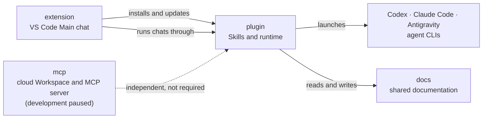

# Agent Factory

This parent repository brings the three Agent Factory components — the extension,
the MCP service, and the plugin — together with the shared project documentation in a
single workspace. Each is an independent Git repository linked as a submodule that
tracks its `main` branch.


## How it works


- **One Conductor, many performers.** You talk to the Conductor; it delegates changes and
  research to performers (Expert, Worker, Explorer or Scribe) in named domains, compares
  each work report with the request's Done criteria, and reports what actually happened.
  Verification runs when you ask for it; direct mode lets the Conductor work itself.
- **Your CLIs, your logins.** Agents run in Codex, Claude Code or Antigravity. When a
  provider's quota runs out, every role moves to another provider automatically.


## Core features

- **Document system:** Organize sources, working knowledge, accepted specifications,
  progress, and lessons with clear ownership and one editable source per document.
- **Contracts → Work–Verification loop:** Define workers, task goals, constraints, the
  file structure, and task order in a versioned contract, execute the contracted tasks,
  record results in the contract, and return verification findings for correction.
- **Interviews:** Resolve material requirements and decisions through guided
  questions, options, and a summary of your choices.
- **Lessons learned:** Record errors and judgment differences, retrieve relevant
  experience before work, and consolidate supported lessons into rules when requested.

The extension also provides the **Control Center** (performers by domain, usage, routing,
logs, documents and notes), per-role **agent settings** with the Maestro set, the chat
workspace (per-message actions, queue, concurrent sessions, isolation) and **Work Units**.
See the [extension guide](https://github.com/KoreanLeeChangHyun/agent-factory-vscode-extension/blob/main/README.md)
for the local workflow and the
[plugin source guide](https://github.com/KoreanLeeChangHyun/agent-factory-plugin-source/blob/main/README.md)
for the runtime, host distributions and tests.
The MCP service is independently operated and is not required by the plugin or extension.

## How the components fit



- The extension drives the local workflow; the plugin owns Skills and the runtime that
  launches the agent CLIs. The MCP service is optional and independently operated.

## Project Structure

| Path | Project | Branch |
| --- | --- | --- |
| [extension/](https://github.com/KoreanLeeChangHyun/agent-factory-vscode-extension/tree/main) | VS Code Main chat interface | `main` |
| [mcp/](https://github.com/KoreanLeeChangHyun/agent-factory-mcp/tree/main) | Independent cloud Workspace and MCP server (development paused) | `main` |
| [plugin/](https://github.com/KoreanLeeChangHyun/agent-factory-plugin-source/tree/main) | Single source for Skills, runtime, and Codex/Claude Code/Antigravity distributions | `main` |
| [docs/](https://github.com/KoreanLeeChangHyun/agent-factory-docs/tree/main) | Shared project documentation | `main` |

- Path links open each repository's `main` branch. GitHub's file list shows
  submodules as `name @ commit` and links to the recorded commit instead.
- The Branch column is the remote branch configured in `.gitmodules`. A local
  checkout may use another branch for ongoing work.

## Clone

Clone the repository together with its submodules:

```bash
git clone --recurse-submodules git@github.com:KoreanLeeChangHyun/agent-factory.git
cd agent-factory
```

If you have already cloned the parent repository without its submodules, initialize them:

```bash
git submodule update --init --recursive
```

## Update

Use the component revisions recorded by the parent repository:

```bash
git pull
git submodule update --init --recursive
```

To advance submodules to their configured remote branches, run
`git submodule update --init --remote --recursive` and review the changed revisions.

To work directly on a project, switch to its directory:

```bash
cd extension    # or mcp, plugin, docs
git status
```

To record new submodule commits in the parent repository, commit the updated pointers from the parent directory:

```bash
cd ..
git add extension mcp plugin docs
git commit -m "chore: update component revisions"
git push
```

## Project Documentation

- The `docs/` submodule owns project documentation. Commit document changes in
  `docs/`, then record the updated pointer in the parent repository.
- Component README and AGENTS.md files are entry points. User-distributed Skills
  in `plugin/skills/` remain separate from developer documentation.

| Location | Purpose |
| --- | --- |
| `docs/original/` | Metadata and links identifying external sources |
| `docs/refined/` | Research, interviews, analysis, and historical records |
| `docs/skills/` | Accepted project information, rules, and designs |
| `docs/progress/` | Versioned contracts, task progress, and execution evidence |
| `docs/lessons-learned/` | Error and judgment records with causes, outcomes, and applications |
| `docs/artifact/<domain>/<filename>` | Standalone demos, retained check evidence, reusable media and versioned release bundles; canonical reports belong in Refined |

- Refined documents retain the `processed` metadata type for compatibility.
- Follow the project documentation rules in `docs/skills/rule-documents/SKILL.md`
  for package structure, source preservation, and ownership.
- After changing `docs/skills/`, run the Document Skill's
  `sync_documents.py --project-root <agent-factory-root> --host antigravity` and check the result.
  `.agents/skills/` (Antigravity) is the derived, ignored project-local Skill path and must
  not be edited directly.

## Requirements

- Python 3.10+.
- At least one of the Codex CLI, Claude Code or the Antigravity CLI. Installed
  runtimes are detected automatically, and their models become available together.

## License

MIT License. See [LICENSE](LICENSE). Each component repository carries its own license.
